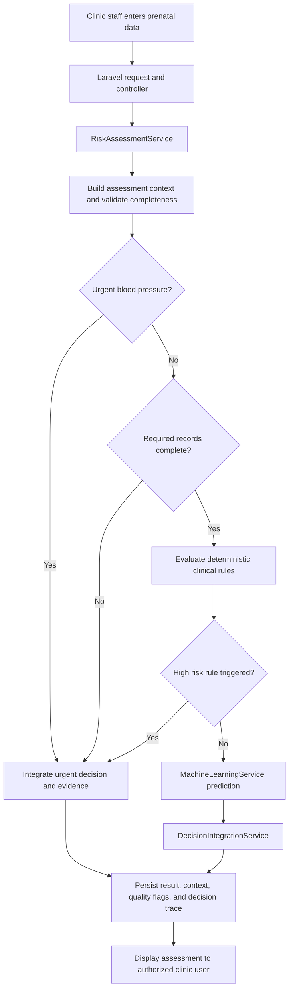

# Appendix: Selected Source Code and System Flow

This appendix presents selected excerpts from the Panganakan maternity Clinical Decision Support System (CDSS). It documents the main assessment pathway and a representative automated reminder workflow without reproducing the full application listing. File paths are relative to the project repository. The complete source should be submitted as a separate digital supplement or repository archive when required by the institution.

## A. System Flow



The workflow uses urgent blood-pressure evaluation before the completeness check. Deterministic clinical rules are evaluated after required records are complete. Machine-learning output is consulted only when no deterministic high-risk reason has already been found. The flow describes the current implementation; it does not define independent clinical guidance.

## B. Risk Assessment Orchestration

**Source:** `app/Services/RiskAssessmentService.php`

The service coordinates smaller assessment components and returns an `AssessmentResult`. This is a shortened explanatory excerpt, not a standalone code listing: helper details and some result-construction lines are omitted for readability. Consult the source file for the complete implementation.

```php
// Capture a single ultrasound record and build the assessment context.
$ultrasound = $this->assessmentContextBuilder
    ->latestUltrasound((int) $patient->id);
$ultrasoundSnapshot = UltrasoundSnapshot::fromModel($ultrasound);
$context = $this->assessmentContextBuilder->buildForPatient(
    $patient, $visit, $inputs, $assessmentDate, null, $ultrasound
);

$dataQualityFlags = $this->assessmentDataQualityService
    ->evaluate($context, $duplicateCounts);
$bpResult = $this->bloodPressureAssessmentService->assess(/* inputs */);

if ($bpResult['triggered'] && $bpResult['reason_code'] === 'BP-URG') {
    // Return urgent decision before the usual completeness gate.
    return $this->finalize($urgentResult, $context, $dataQualityFlags, []);
}

if (! empty($missingRecords)) {
    return $this->finalize($incompleteResult, $context, $dataQualityFlags, []);
}

$evidence = $this->clinicalRuleEngine->evaluateDetailed(
    $patient, $inputs, $ultrasoundSnapshot
);

if (! empty($evidence)) {
    return $this->finalize($ruleBasedResult, $context, $dataQualityFlags, $evidence);
}

$mlResult = $this->machineLearningService->predict($patient, $inputs);
return $this->finalize(
    $this->decisionIntegrationService->decide([], [], $mlResult, null, null, []),
    $context,
    $dataQualityFlags,
    []
);
```

**Design rationale.** Assessment coordination is separated from individual rule, data-quality, and machine-learning components. Reusing the captured ultrasound snapshot keeps the decision input aligned with the assessment context saved for later review. This excerpt intentionally omits the clinical thresholds; those remain defined in their respective services and should not be changed as part of documentation work.

## C. Appointment Reminder Verification Example

**Source:** `tests/Feature/AppointmentEmailReminderTest.php`

The feature test checks the reminder command at each configured lead time and verifies that delivery is recorded for the expected reminder type.

```php
it('sends each reminder at its lead time using the confirmed schedule',
    function (string $type, int $leadMinutes) {
        $schedule = Carbon::parse(
            '2026-11-05 10:00:00', AppointmentReminderService::TIMEZONE
        );
        Carbon::setTestNow($schedule->copy()->subMinutes($leadMinutes));
        Mail::fake();

        $appointment = appointmentReminderAppointment(
            appointmentReminderPatient(), [
                'confirmed_date' => $schedule->toDateString(),
                'confirmed_time' => '10:00:00',
            ]
        );

        $this->artisan('appointments:send-reminders')->assertSuccessful();

        Mail::assertSent(AppointmentReminderMail::class, fn ($mail) =>
            $mail->appointment->is($appointment)
            && $mail->reminderType === $type
        );
    }
)->with([
    'one week' => ['one_week', 7 * 24 * 60],
    'three days' => ['three_days', 3 * 24 * 60],
    'two hours' => ['two_hours', 120],
]);
```

The same test file covers duplicate prevention, exclusion of ineligible appointments, invalid or missing email addresses, rescheduling, expired reminder windows, and failed delivery. These cases support the reminder implementation but do not establish clinical effectiveness.

## D. Source and Verification Index

| Area | Representative files | What they show |
|---|---|---|
| Risk assessment | `app/Services/RiskAssessmentService.php` | Assessment order, safety gate, and component orchestration |
| Deterministic clinical rules | `app/Services/ClinicalRuleEngine.php` | Rule-based factor evaluation |
| Model integration | `app/Services/MachineLearningService.php`; `maternal-risk-ml/predict.py` | Application-to-model prediction boundary |
| Decision explanation | `app/Services/DecisionTraceBuilder.php`; `app/ValueObjects/AssessmentResult.php` | Structured decision and trace data |
| Automated reminders | `app/Services/AppointmentReminderService.php`; `app/Console/Commands/SendAppointmentReminders.php` | Reminder eligibility and scheduled execution |
| Verification examples | `tests/Feature/AppointmentEmailReminderTest.php`; `tests/Feature/ExplainabilitySprint7Test.php` | Representative feature-level behavior checks |

## E. Full Source Supplement and Reproducibility

The full project source is maintained in the accompanying Panganakan repository. Submit a copy of that repository as the digital source-code supplement, or provide the institution-approved repository URL. Record the exact revision included with the submission so reviewers can match the code to this appendix. The current local revision when this appendix was prepared is `7ff9734`; confirm the submitted archive uses that revision or update this identifier after final edits.

## F. Verification Note

The project implementation notes report focused appointment reminder tests, but also record that test execution was blocked before assertions by duplicate `babies.deleted_at` migrations. Therefore, this appendix identifies the test coverage present in the source and does not claim that the complete test suite passed. Any test execution for this project must follow the repository's SQLite in-memory isolation safeguards documented in `Agents.md`.
